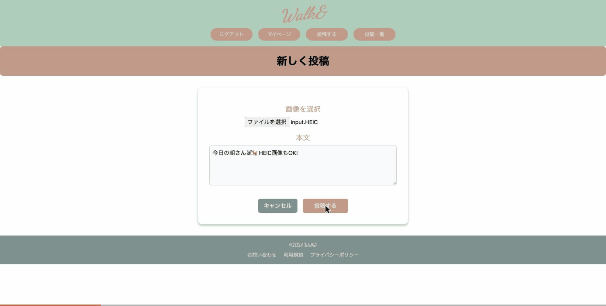
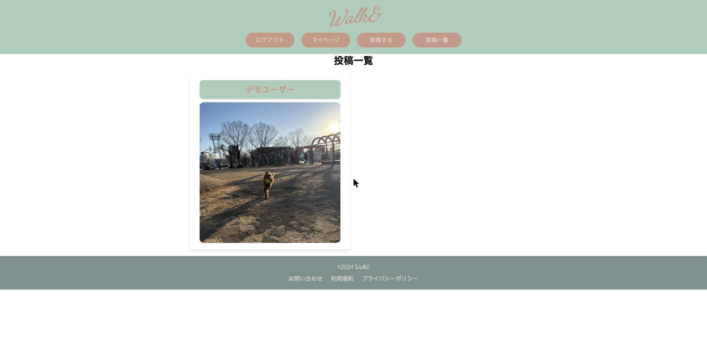
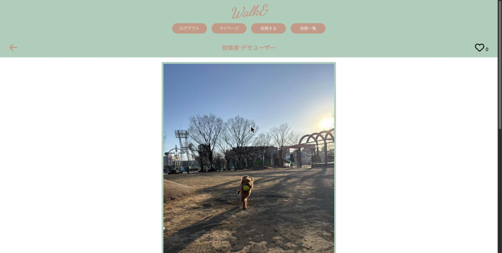

<div align="center">


# Walk&

**愛犬の「お散歩」と「ごはん」を記録して、写真をみんなで共有するサービス**


</div>

> [!NOTE]
> 本サービスは**本番運用を終了**しました(旧URL: https://walk-and.net)。\
> 現在は開発環境(Docker)で動作確認できます。手順は [開発環境の起動](#-開発環境の起動) を参照してください。

## 目次

- [サービス概要](#-サービス概要)
- [サービスへの思い](#-サービスへの思い)
- [ターゲットと差別化](#-ターゲットと差別化)
- [機能紹介](#-機能紹介)
- [技術スタック](#-技術スタック)
- [開発環境の起動](#-開発環境の起動)
- [画面遷移図・ER図](#-画面遷移図er図)

## 🐕 サービス概要

**Walk&** は、毎日のワンちゃんのお散歩とごはんの時間を記録しながら、愛犬の写真を共有して楽しむサービスです。\
お散歩やごはんの時間を可視化して記録を楽しみ、みんなで写真を共有して愛犬家の輪を広げていきたいと考えて作りました。

## 💭 サービスへの思い

私の祖母は、飼っているワンちゃんに「お散歩したっけ?」「ごはんあげたっけ?」とよく聞いていました。
記憶力が弱くなっていく姿を見ていて、また自分がワンちゃんの写真を撮るのが好きだったことから、
**お散歩とごはんを記録でき、みんなで写真を共有できるサービス**を作りたいと思いました。\
お年寄りでも楽しみながら記録できるアプリを目指しています。

## 🎯 ターゲットと差別化

### 対象ユーザー

**子供とお年寄り**

### 理由

20〜30代向けには、散歩をしながら遊べる「ポケモンGO」「ドラクエウォーク」などがあります。
一方、散歩中にスマホを操作するのは子供やお年寄りには負担が大きいため、**帰ってからスマホで簡単に記録**でき、
子供でもわかりやすく気軽に投稿できるようにしています。

### 他のアプリとの違い

似たアプリには、GPSで距離を測ったりカロリーを表示したりするものがありますが、
アプリを開きながら散歩をするのはこのターゲット層には向かないと考え、シンプルでわかりやすい見た目にしました。
記録と健康管理のアプリは多い一方、記録しつつ気軽に写真を投稿できるアプリは少ないと感じたことも理由です。

|  | Walk& | 他のアプリ |
|---|---|---|
| 記録機能 | ✅ お散歩・ごはんを記録 | ✅ お散歩距離・カロリーを記録 |
| 写真投稿 | ✅ 可能 | ❌ できない / 共有範囲が限定的 |
| 操作の簡単さ | ✅ シンプルな操作 | ❌ GPS記録など複雑な操作が必要 |
| 対象ユーザー | ✅ 子供・お年寄り | ❌ 20〜30代向けが多い |

## ✨ 機能紹介

| 機能 | 説明 |
|---|---|
| 投稿 | ワンちゃんの写真を投稿できる(iPhoneのHEIC画像にも対応) |
| いいね・コメント | 他のユーザーの投稿にいいね・コメントできる |
| マイページ | 自分の投稿一覧・いいね一覧を確認できる |
| 記録 | お散歩・ごはんの時間をカレンダーで記録できる |
| LINE連携 | LINEログイン、およびLINEからお散歩・ごはんを記録できる |

> **LINEからの記録**: ログイン前のページから公式LINEを追加すると、LINEから簡単に「お散歩」「ごはん」を記録できます。

### 画面イメージ

<table>
  <tr>
    <td align="center"><b>ログイン</b><br></td>
    <td align="center"><b>LINEログイン</b><br></td>
  </tr>
  <tr>
    <td align="center"><b>投稿一覧</b><br></td>
    <td align="center"><b>投稿</b><br></td>
  </tr>
  <tr>
    <td align="center"><b>コメント</b><br></td>
    <td align="center"><b>マイページ</b><br></td>
  </tr>
  <tr>
    <td align="center"><b>記録</b><br></td>
    <td align="center"><b>記録の詳細</b><br></td>
  </tr>
  <tr>
    <td align="center"><b>LINEからの記録</b><br></td>
    <td align="center"><b>お問い合わせ</b><br></td>
  </tr>
</table>

## 🛠 技術スタック

| カテゴリ | 技術 |
|---|---|
| フロントエンド | TailwindCSS, Stimulus (Hotwire) |
| バックエンド | Ruby 3.3.6 / Rails 7.2.2 |
| データベース | PostgreSQL |
| 画像 | CarrierWave, MiniMagick, Cloudinary, AWS S3 |
| 外部API | LINE API |
| インフラ(運用時) | Render.com |
| 開発環境 | Docker, Docker Compose |

## 🚀 開発環境の起動

Docker Desktop が必要です。Cloudinary / AWS S3 の認証情報は不要で、画像はローカル(`public/uploads`)に保存されます。

```bash
docker compose build
docker compose run --rm --no-deps web yarn install   # 初回のみ(node_modules)
docker compose up
# → http://localhost:3000
```

ログイン用のユーザーを作成します。

```bash
docker compose exec web bin/rails runner \
  'User.create!(name: "デモユーザー", email: "demo@example.com", password: "password123")'
```

終了するときは `docker compose down` を実行してください。

### 動作デモ: HEIC画像の投稿

iPhoneで撮影したHEIC画像を投稿すると、JPEGに変換されて表示されます。

<p align="center">
  
</p>

<table>
  <tr>
    <td align="center"><b>投稿一覧</b><br></td>
    <td align="center"><b>投稿詳細</b><br></td>
  </tr>
</table>

<details>
<summary>HEIC画像の変換について</summary>

- Dockerイメージ(Debian bookworm)標準の libheif 1.15 はiPhone撮影のHEICを読めず変換に失敗するため、`Dockerfile.dev` で bookworm-backports の新しい libheif を導入しています。
- 環境変数 `CLOUDINARY_CLOUD_NAME` などを設定するとCloudinary経由の変換になります。未設定の場合はMiniMagickで変換します。

</details>

## 🗺 画面遷移図・ER図

### 画面遷移図


### ER図


